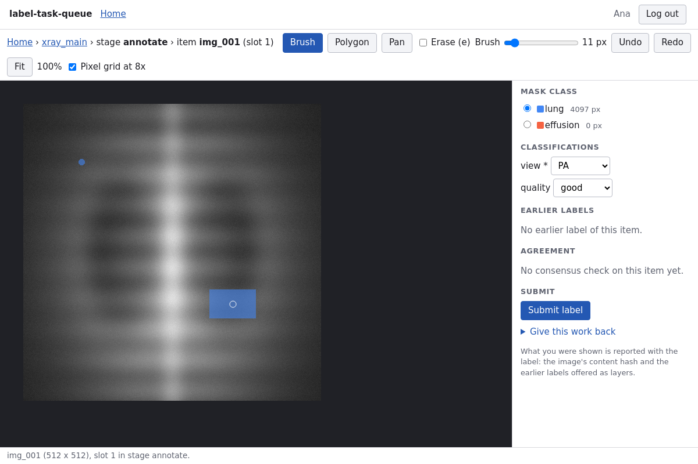
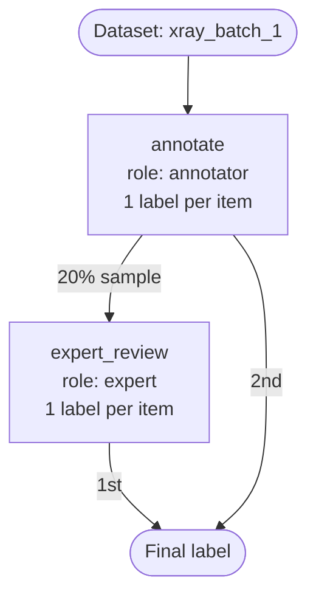

# label-task-queue

**Auditable labeling workflows for research data.**

You run a labeling project: a few hundred chest X-rays, three annotators, one radiologist
whose time is scarce. You want every image labeled once, a random fifth of them checked by
the expert, and, when a reviewer later asks, a straight answer to *why did image 17 go to
the expert?* and *where did its final label come from?*

With this tool you write the plan as a short YAML file. The system hands out the work
(labelers ask for the next image and claim it), draws the samples, runs the consensus check,
decides each final label, and records every one of those decisions in an append-only event
log together with the rule that caused it. Nothing is decided by hand and nothing is decided
silently.

It is a Python package, `labelflow`, with a web API and a browser interface on top: labelers
draw masks with a brush or polygon and pick classifications; admins upload workflows, watch
progress and download exports.



## A workflow in twelve lines

```yaml
workflow: xray_main
dataset: xray_batch_1
label_task: image_ontology@1      # the ontology file: what a label is

stages:
  - name: annotate
    assign_to: annotator          # anyone with the 'annotator' role; one label per image

  - name: expert_review
    input: annotate               # takes the images that completed 'annotate'...
    assign_to: expert
    sample: 0.2                   # ...but only 20% of them, by a reproducible draw

final: [expert_review, annotate]  # the review label wins where there is one
```

The diagram is drawn from the config, so it cannot disagree with it:



**What happens to one image.** `img_003` enters the workflow and `annotate` opens one slot
for it. Ben asks for work, claims the slot, and submits a label. The image leaves `annotate`
and `expert_review` decides whether to admit it: its draw is 0.1374, below 0.2, so a slot
opens. Dr Smith claims it and submits a label. No stage takes the image further, so the final
step runs: `expert_review` is the first stage listed in `final` that labeled it, so the
expert's label becomes the final label.

**And the trace that proves it.** `explain(item)` reads the event log and prints every event
about the image with its cause (this is the output of `examples/quickstart.py`, trimmed):

```text
item img_003  in workflow xray_main  status: final
  rule: expert_review is the first listed stage that labeled it (1 label, label 5)

10-12 09:22  admission    admitted to annotate: 1 slot(s) opened (3)
             because      annotate has no input, so it takes every item of the dataset; annotate.sample = 1 (every item, no draw); annotate.labels_per_item = 1
10-12 09:27  claimed      slot 3 of annotate by ben (annotator)
             because      ben asked for work; first eligible open slot in the default order (later stages first, then the oldest admitted item); annotate.assign_to = annotator and ben holds annotator
10-12 09:28  labeled      label 3 by ben (annotator) in annotate: {"classifications":{"quality":"good","view":"PA"},"masks":{… (1m 17s)
10-12 09:28  admission    admitted to expert_review: 1 slot(s) opened (13)
             because      expert_review.input = annotate; expert_review.sample = 0.2 (draw 0.1374 < 0.2, admitted); expert_review.labels_per_item = 1
10-12 09:31  claimed      slot 13 of expert_review by dr_smith (expert)
10-12 09:32  labeled      label 5 by dr_smith (expert) in expert_review: {"classifications":{"quality":"good","view":"PA"},"masks":{… (1m 16s)
10-12 09:32  final        from expert_review (label 5): {"classifications":{"quality":"good","view":"PA"},"masks":{…
             because      final = [expert_review, annotate]: expert_review is the first listed stage that labeled it (1 label, label 5)
```

The draw is `hash(workflow seed, stage, image)`, so anyone with the seed can recompute it,
and the sampling report shows the rate that was actually drawn, overall and per annotator.

## Quick start

### Install

Requires Python 3.12.

```bash
git clone <this repository> && cd label-task-queue
python3.12 -m venv env && source env/bin/activate
pip install -e ".[dev]"
```

### Run the demo (no server, no database)

```bash
python examples/quickstart.py
```

This builds a project in memory, starts two of the example workflows, lets simulated
labelers work through them, and prints the feedback tools: progress, the sampling report,
the `explain` trace above, the items export, and the score report of a training round. The
run is seeded, so it prints the same thing every time. It is about 200 lines and is the
best introduction to the Python API; [`examples/README.md`](examples/README.md) lists what
else is there.

### The Python API in twenty lines

The same thing by hand. One `Engine` is one project; the in-memory store keeps the same
event log the SQLite store does.

```python
from labelflow.engine import Engine, InMemoryStore
from labelflow.engine.config import validate_config
from labelflow.labeltask import LabelTaskRegistry, load_ontology

ontology = load_ontology("examples/ontologies/chest_xray.yaml")
engine = Engine(InMemoryStore(), LabelTaskRegistry([ontology]))

for role in ("annotator", "expert"):  # roles are project state; the config only names them
    engine.define_role(role, actor="admin")
engine.grant_role("ana", "annotator", actor="admin", reason="joined the study")
engine.create_dataset("xray_batch_1", actor="admin")
engine.import_item(
    "xray_batch_1", "img_001", "file:///data/img_001.png", "sha256...", actor="admin"
)

report = validate_config(open("examples/workflows/review_sample.yaml").read())
engine.start_workflow(report.config, seed=2053, actor="admin")

slot = engine.request_work("xray_main", "ana")  # ana asks for work and claims a slot
packet = engine.work_packet("xray_main", slot.slot, "ana")  # what the interface should show her
label = {
    "classifications": {"view": "PA"},
    "masks": {
        "lung": {"size": [16, 16], "counts": [0, 256]},
        "effusion": {"size": [16, 16], "counts": [256]},
    },
}
engine.submit("xray_main", slot.slot, "ana", label, packet.shown())
print(engine.explain("xray_main", "img_001").render())
```

Every command runs in one transaction and either appends events or raises an `EngineError`
with a plain-language message. `engine.export_items`, `export_labels`, `score_report`,
`sampling_report`, `preview_edit` and `activate_edit` are the rest of the admin side.

### Run the server

```bash
./run.sh                                               # migrates the database, then serves on :8000
python -m labelflow.api.admin create-admin root        # once; asks for a password
```

`run.sh` runs `alembic upgrade head` first, keeps the database in `./db/`, and loads the
label tasks from `examples/ontologies/`. Open `http://localhost:8000/ui/` for the interface
(see [`docs/ui/`](docs/ui/README.md)); the interactive API docs are at
`http://localhost:8000/docs`. Settings are environment variables:

| Variable | Default | Meaning |
| --- | --- | --- |
| `DATABASE_URI` | `sqlite:///./db/labelflow.db` | The SQLite database. |
| `LABELFLOW_LABEL_TASKS` | `./ontologies` (`run.sh`: `examples/ontologies`) | Folder of ontology files. |
| `LABELFLOW_MEDIA_ROOT` | not set | Folder the server may read images from, to hash them at import. Without it, every imported item must come with its `content_hash`. |
| `LABELFLOW_MAX_REQUEST_MB` | `20` | Largest request body accepted. |
| `LABELFLOW_MAX_LABEL_KB` | `4096` | Largest submitted label. |
| `LABELFLOW_MAX_PROPERTIES_KB` | `256` | Largest `properties` of one imported item. |
| `LABELFLOW_MAX_IMPORT_ITEMS` | `10000` | Most items in one import batch. |
| `LABELFLOW_SESSION_HOURS` | `12` | How long a login lasts. |
| `LABELFLOW_COOKIE_SECURE` | `false` | Set to `true` when the service is served over https. |
| `LABELFLOW_ADMIN_PASSWORD` | not set | Lets `create-admin` run without a prompt. |

With Docker, the container migrates on start and the first admin is made the same way:

```bash
docker compose up --build
docker compose run --rm app sh -c "alembic upgrade head && python -m labelflow.api.admin create-admin root"
```

### The same project over HTTP

Log in and keep the token; every other call sends it. (`jq` is used to wrap the YAML file
in a JSON body.)

```bash
API=http://localhost:8000; J='Content-Type: application/json'
TOKEN=$(curl -s -X POST $API/auth/login -H "$J" -d '{"username":"root","password":"..."}' | jq -r .token)
AUTH="Authorization: Bearer $TOKEN"

# accounts, a project, roles and who holds them (every role change is logged with its reason)
curl -s -X POST $API/accounts -H "$AUTH" -H "$J" -d '{"username":"ana","password":"a-password-for-ana"}'
curl -s -X POST $API/projects -H "$AUTH" -H "$J" -d '{"name":"xray"}'
curl -s -X POST $API/projects/xray/roles -H "$AUTH" -H "$J" -d '{"role":"annotator"}'
curl -s -X POST $API/projects/xray/roles/annotator/grant -H "$AUTH" -H "$J" -d '{"user":"ana","reason":"joined the study"}'

# a dataset and its items: an address plus the SHA-256 of the image (or let the server hash a file it can read)
curl -s -X POST $API/projects/xray/datasets -H "$AUTH" -H "$J" -d '{"name":"xray_batch_1"}'
curl -s -X POST $API/projects/xray/datasets/xray_batch_1/items -H "$AUTH" -H "$J" -d '{"items": [
  {"item": "img_001", "uri": "https://files.example.org/xray/img_001.png", "content_hash": "2b05a7816660a96479b5d8fcb640093e053bc4db36bfa70cd3fc3b46f4ebb9e0"}]}'

# check the config (errors, warnings, the resolved config and the diagram), then start it
jq -Rs '{config: .}' examples/workflows/review_sample.yaml | curl -s -X POST $API/projects/xray/workflows/validate -H "$AUTH" -H "$J" -d @-
jq -Rs '{config: ., seed: 2053}' examples/workflows/review_sample.yaml | curl -s -X POST $API/projects/xray/workflows -H "$AUTH" -H "$J" -d @-
```

A labeler logs in the same way, then asks for work and submits:

```bash
ANA="Authorization: Bearer $(curl -s -X POST $API/auth/login -H "$J" -d '{"username":"ana","password":"a-password-for-ana"}' | jq -r .token)"
WORK=$(curl -s -X POST $API/projects/xray/workflows/xray_main/next -H "$ANA")   # 204 when there is nothing
SLOT=$(echo "$WORK" | jq .slot.slot)                                             # .packet has the uri, hash, earlier labels
echo "$WORK" | jq '{label: {classifications: {view: "PA"}, masks: {lung: {size: [16,16], counts: [0,256]},
  effusion: {size: [16,16], counts: [256]}}}, shown: .shown, duration_ms: 42000}' \
  | curl -s -X POST $API/projects/xray/workflows/xray_main/slots/$SLOT/submit -H "$ANA" -H "$J" -d @-
```

A label that does not fit the ontology is refused (422) with every problem spelled out, and
the slot stays claimed. `POST .../slots/{slot}/release` with a reason gives it back.

The admin's feedback calls:

```bash
curl -s $API/projects/xray/workflows/xray_main -H "$AUTH" | jq .progress            # items and slots by status
curl -s $API/projects/xray/workflows/xray_main/items/img_001/explain -H "$AUTH" | jq -r .text
curl -s $API/projects/xray/workflows/xray_main/reports/sampling -H "$AUTH"
curl -s $API/projects/xray/workflows/xray_main/reports/scores -H "$AUTH"
curl -s "$API/projects/xray/workflows/xray_main/exports/items?format=csv" -H "$AUTH"   # or parquet; also exports/labels
curl -s "$API/projects/xray/events?type=label_submitted" -H "$AUTH"                    # the audit view of the log
```

## The config vocabulary

A config is a YAML document with five top-level keys. The validator reports every mistake
in plain language and refuses invented keys; the published JSON Schema is
[`schema/workflow-config.schema.json`](schema/workflow-config.schema.json).

| Key | Required | Meaning |
| --- | --- | --- |
| `workflow` | yes | The workflow's name, unique in the project. |
| `dataset` | yes | The dataset whose items enter. Items imported later enter as they arrive. |
| `label_task` | yes | The label task, `name@version`, such as `image_ontology@1`. It defines what a label is, validates labels, and judges agreement. |
| `stages` | yes | The stages, in order. Order also sets the default work order: later stages are offered first, so items finish. |
| `final` | no | Where final labels come from: an ordered list of stages; the first listed stage that labeled an item supplies its final label. `none` means no final labels (a training round). Default: every stage, last listed first. |

Each stage has:

| Key | Default | Meaning |
| --- | --- | --- |
| `name` | required | Unique in the workflow. |
| `input` | the dataset | Where items come from: an earlier stage (`annotate`), or only the items whose labels there agreed (`annotate.agreed`) or disagreed (`annotate.disagreed`). |
| `assign_to` | required | A role or list of roles. Anyone holding one of them may claim the stage's slots, except for an item they already labeled anywhere in this workflow. |
| `sample` | `1` | The fraction of arriving items admitted, by a hashed draw (`0.2` is 20%). Must be above 0. |
| `labels_per_item` | `1` | How many different people label each admitted item: a number; `all` (everyone holding the roles when the item is admitted); or `{count: 3, fraction: 0.2}` (20% of admitted items get 3 labels, the rest 1). |
| `score_against` | none | An item property holding a key, such as `gold_key`. Each label is compared with it by the label task's consensus check. It changes no routing; items without the key are logged as `no_key`. |
| `show_prior` | `true` | Whether labelers are shown the item's earlier labels (from other stages, without names) with the agree/disagree flags. `false` makes the stage blind. |

**Outputs.** Every item that completes a stage is in that stage's plain output. An item that
received two or more labels there is also in `.agreed` or `.disagreed`, as the label task
judged. Items labeled once appear only in the plain output, so `.agreed` and `.disagreed` are
only allowed on a stage that can give several labels.

**The rule that keeps items from getting lost.** Every stage must either be listed in `final`
or pass all of its output on: to a stage that takes its whole output unsampled, or to stages
taking both its `.agreed` and `.disagreed` items. The validator refuses a config where an
item could finish with no final label. Two more rules: the roles a config names must already
be defined in the project, and a stage whose roles have fewer people than
`labels_per_item` asks for gets a warning (at start and on every role change).

**Resolved view.** `GET .../workflows/{w}` (or `labelflow.engine.config.resolved_yaml`)
shows the active config with every default filled in and a comment on each line, plus the
diagram. The five files in [`examples/workflows/`](examples/workflows/) cover every key with
a comment on each decision: review a sample, adjudicate disagreements, a training round
scored against a gold key, a gold-standard quality check mixed into ordinary labeling with a
blind review, and agreement measured on a 20% subset.

## How work moves

- **Items flow, people claim.** Admitting an item to a stage opens one slot per needed
  label. A labeler asks for work and claims the first open slot they are eligible for: later
  stages first, then the oldest admitted item. Nobody is assigned work in advance, so an
  absent labeler holds nothing up, and a role change takes effect at the next claim.
- **One claim at a time** per person per workflow. Asking again returns the same slot.
- **Submit** validates the label against the label task, logs it together with references to
  what the labeler was shown (the image's content hash, the ids of earlier labels, the
  `show_prior` setting, the consensus rule version), and moves the item on. **Release** gives
  the slot back with a reason; that person is offered the item again only after all their
  other work.
- **An item leaves a stage** as soon as all its slots are filled; the consensus check runs if
  there were two or more labels. Every downstream stage decides admission at that moment.
  When no stage holds the item any more, the final step runs and logs the final label (or
  `unresolved`, if the labels of the source stage disagreed).
- **Admin actions**, each a logged event with a reason: exclude an item from a workflow
  (`POST .../items/{item}/exclude`; allowed even after its final label, which then stays in
  the log as history), cancel a stage's open slots (`.../stages/{stage}/cancel-open-slots`),
  and pause or resume a stage or a whole workflow (`.../pause`, `.../resume`,
  `.../stages/{stage}/pause`, `.../stages/{stage}/resume`; in Python `pause_workflow`,
  `resume_workflow`, `pause_stage`, `resume_stage`). A pause stops claims only: items keep
  arriving and their slots wait, and claims already held can still be submitted or released.
  A stage's pause and its workflow's pause are independent.
- **Editing a running workflow** is forward-only. Send the whole new config to
  `POST .../workflows/{w}/preview-edit` to see each change, whether it would be refused, a
  diff, and counts of the items and slots it touches; then `POST .../workflows/{w}/edits`
  with the version you previewed against. The new version governs only decisions made from
  then on; every existing label and final label keeps the version it was made under. In
  place: `sample`, `labels_per_item`, `score_against`, `show_prior`, `assign_to`, `final`,
  adding a stage, removing a stage with no open slots. Needs a new workflow: the dataset, the
  label task, a stage's input or name.

## Feedback tools

| Tool | Python | HTTP | What it answers |
| --- | --- | --- | --- |
| Explain | `engine.explain(w, item).render()` | `GET .../items/{item}/explain` | Why the item went where it went, with the draw and threshold of each sampling decision, the config version in force, and, if it is waiting, why (who could claim it and what they are doing instead). |
| Items export | `engine.export_items(w)` | `GET .../exports/items?format=csv\|parquet` | One row per item: status (`in_progress`, `final`, `unresolved`, `none`, `excluded`), the final label, its source stage, the label ids and the rule that chose them, the config version. |
| Labels export | `engine.export_labels(w)` | `GET .../exports/labels?format=csv\|parquet` | One row per label: labeler, the roles they held then, stage, config version, ontology version, claim and submit times, what they were shown, the score against the key, and the label itself. |
| Score report | `engine.score_report(w)` | `GET .../reports/scores` | Per stage with `score_against` and per labeler: labels, scored, `no_key`, agreed, fraction agreed. |
| Sampling report | `engine.sampling_report(w)` | `GET .../reports/sampling` | Per stage: items arrived, admitted and the actual rate, overall and per upstream labeler. |
| Resolved config and diagram | `resolved_yaml`, `to_mermaid` | `GET .../workflows/{w}`, `POST .../workflows/validate` | The config with every default filled in; the Mermaid flowchart. |
| Change preview | `engine.preview_edit(w, config)` | `POST .../workflows/{w}/preview-edit` | What an edit would change and touch, before it is activated. |
| Event log | `engine.store.events()` | `GET /projects/{p}/events` | Every event, oldest first, with its `because`. Each event stores the hash of the one before it. |

The derived tables (slots, labels, final labels) are rebuilt from the log and compared in the
test suite, and on a deployment with
`python -m labelflow.store.rebuild "$DATABASE_URI" --project <name> --verify-only`.

## The pilot

Milestone 8 runs the anchor project on real data. The recommended kit is
[`pilot/montgomery/`](pilot/montgomery/README.md): the NLM's Montgomery County chest
X-rays, 138 images. The download is open, with no registration. Each image has a mask of
each lung and a TB label, which serve as the gold standard. The kit holds:

- the ontology and the two workflows (a training round on 12 gold images, and the main
  run);
- scripts to prepare the data, set up a server and export everything for the audit;
- made-up accounts.

Its README starts with a quick start that runs end to end in a few minutes. The older
[`pilot/jsrt/`](pilot/jsrt/README.md) kit is kept as an alternative: JSRT images with the
SCR segmentations of five structures. The JSRT images need registration. Both kits share
`pilot/common/`.

## Project layout

| Path | What it holds |
| --- | --- |
| `src/labelflow/engine` | The workflow engine: config models and validation, stages, slots and claims, the event log, explain, exports, edits to a running workflow. Plain Python; no web or database code. |
| `src/labelflow/labeltask` | Label tasks: the built-in ontology label task, COCO RLE masks, the consensus check. |
| `src/labelflow/store` | SQLite storage for the engine (SQLAlchemy 2), Alembic migrations, the rebuild command. |
| `src/labelflow/api` | The web API (FastAPI): accounts and login, projects, roles, datasets, workflows, labeler and admin endpoints, exports. |
| `src/labelflow/ui` | The browser interface: login, labeling with brush and polygon masks, review layers, admin pages. Server-rendered (Jinja2 + htmx). |
| `examples/` | The runnable demo, the worked workflow files, and the chest X-ray ontology. |
| `pilot/` | The pilot kits: `montgomery/` (recommended), `jsrt/`, and the code they share in `common/`. |
| `schema/` | The published JSON Schema of the config (`python -m labelflow.engine.config.schema` regenerates it). |
| `docs/` | The design notes and implementation notes. |

## Testing

```bash
./test.sh           # ruff check, ruff format --check, pytest
```

The engine tests run twice, once on the in-memory store and once on SQLite, and include
Hypothesis property tests: rebuilding from the log reproduces the state exactly, draws are
deterministic, nobody labels an item twice in a workflow, no slot is claimed twice. Every
API endpoint has tests, including its error paths. `tests/examples/` runs the demo and
checks its output; `tests/config/` validates the example workflows and keeps snapshots of
their resolved form and diagrams.

## Status

This is the Phase 1 rewrite. The engine, the built-in label task, SQLite storage, edits,
the API and the browser interface are done. The pilot kit for a real dataset
([`pilot/montgomery`](pilot/montgomery/README.md)) is ready and has been dry-run on the real
data with made-up accounts. The pilot itself, with real participants, is next.

- [`docs/phase1-design-notes.md`](docs/phase1-design-notes.md): the design, and why.
- [`docs/phase1-implementation-notes.md`](docs/phase1-implementation-notes.md): status by
  milestone, and every decision the implementation made that the design left open.
- The earlier prototype is in the git history at `e77c9d0`.
